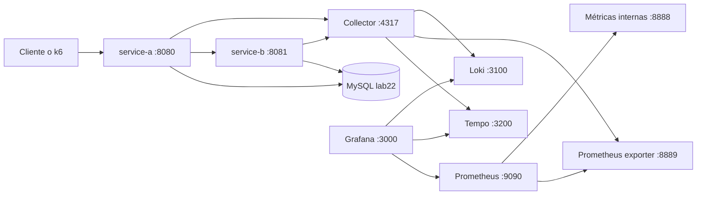

# Arquitectura de Lab 2.2

## Decisión de una frase

Dos microservicios Spring Boot 3.5 componen un pedido con su inventario. El OpenTelemetry Java Agent 2.31.1 instrumenta HTTP y JDBC. El código solo añade spans y métricas de negocio. Un Collector 0.162.0 reparte trazas a Tempo, métricas a Prometheus y logs a Loki. Grafana es la consola donde esas tres señales se cruzan con el `trace_id`.

MySQL sustituye a PostgreSQL porque el laboratorio pide una base relacional de ese motor y el conector JDBC queda cubierto por el agente. No se añadió Jaeger: Tempo ya guarda las trazas y es el datasource que Grafana usa para saltar desde un log.

## Componentes locales

| Componente | Imagen o artefacto | Función |
|---|---|---|
| service-a | `lab22/service-a:1.0.0` | `GET /api/orders/{orderId}` lee `orders` y llama a service-b |
| service-b | `lab22/service-b:1.0.0` | `GET /api/inventory/{sku}` y `POST .../reservations` |
| MySQL 8.4 | `mysql:8.4` | Pedidos e inventario de demostración |
| Collector | `otel/opentelemetry-collector-contrib:0.162.0` | Recibe OTLP, limita memoria, agrupa y exporta |
| Tempo 2.8.1 | `grafana/tempo:2.8.1` | Almacén de trazas consultable por Grafana |
| Loki 3.4.2 | `grafana/loki:3.4.2` | Almacén de logs con metadata de `trace_id` |
| Prometheus 3.4.1 | `prom/prometheus:v3.4.1` | Scrapea `:8889` y `:8888` |
| Grafana 11.6.0 | `grafana/grafana:11.6.0` | Dashboard y saltos entre señales |

## Flujo de una consulta

`GET /api/orders/ord-001` sigue este orden:

1. El agente abre el span servidor `GET /api/orders/{orderId}` en service-a y anota método, ruta y código.
2. `OrderFulfillmentService` abre el span interno `order.compose` con `order.id` y `product.sku`.
3. `JdbcTemplate` ejecuta el `SELECT` de `orders`. El agente añade el span de base de datos como hijo.
4. `RestClient` llama a `http://service-b:8081/api/inventory/LAPTOP-X1`. El agente envía la cabecera W3C `traceparent`.
5. service-b continúa la misma traza, abre `inventory.lookup` y ejecuta su `SELECT`.
6. service-a calcula `stockSufficient` (`available >= quantity`) y responde JSON con `traceId`.
7. Los logs emitidos dentro del span llevan `trace_id` y `span_id` en el MDC. El agente también los exporta por OTLP.
8. El Collector escribe la traza en Tempo, la métrica en el endpoint Prometheus y el log en Loki.

No hay un span manual llamado `fetch.order.db`. Ese nombre, en el ejemplo de Python, repetía lo que ya hace la instrumentación del driver. Aquí el span manual describe la regla de negocio y el span JDBC describe la sentencia.

## Recorrido de cada señal

### Trazas

SDK del agente → OTLP gRPC `otel-collector:4317` → `memory_limiter` → `resource` → `filter/health` → `batch` → exporter `otlp_grpc/tempo` → Tempo `4317` interno → Grafana datasource `tempo`.

El muestreo de cabeza está en el proceso Java, no en el Collector: `OTEL_TRACES_SAMPLER=parentbased_traceidratio` y `OTEL_TRACES_SAMPLER_ARG=1.0` en local. Un valor 1 significa conservar todas las trazas para poder enseñar la correlación. En un entorno con mucho tráfico ese argumento baja, por ejemplo a `0.1`, sin cambiar código.

### Métricas

El agente agrega `http.server.request.duration`, métricas JVM y los contadores de negocio `orders.composed` e `inventory.lookups`. Cada 15 segundos los envía por OTLP. El Collector los expone en `:8889/metrics` con sufijos de Prometheus y con `service.name` como etiqueta. Prometheus scrapea ese endpoint. No hay un segundo registro Micrometer: evitaría duplicar la tasa de requests.

CPU y memoria del panel son `jvm_cpu_recent_utilization_ratio` y `jvm_memory_used_bytes`. Miden el proceso de cada servicio. No miden el nodo ni el contenedor del Collector. El nombre sin el sufijo `_ratio` no existe en la traducción Prometheus de esta versión del agente.

### Logs

Logback escribe JSON a stdout con el encoder de Logstash. Dentro de un span válido, `TraceMdc` rellena `trace_id` y `span_id` si el agente todavía no lo hizo. El agente, con `OTEL_LOGS_EXPORTER=otlp`, manda el mismo evento al Collector. El processor `transform/logs` copia el identificador al atributo y al cuerpo (`trace_id=<32 hex>`), que es el texto que Grafana usa como enlace hacia Tempo.

## Entornos que no son el portátil

El compose local no incluye exporters de GCP ni de AWS. Esos exporters exigen credenciales y harían fallar el arranque.

- **GKE.** Terraform crea red, clúster zonal, Artifact Registry y la cuenta del Collector con permisos de Cloud Trace, Cloud Logging y Cloud Monitoring. Los manifiestos de `deploy/gcp/k8s` despliegan MySQL, los dos servicios y el Collector con `collector-gcp.yaml`.
- **ECS Fargate.** Terraform crea VPC pública, balanceador, cluster, roles y la task definition. La task lleva Collector, MySQL y los dos servicios en la misma red `awsvpc`, así que se hablan por `127.0.0.1`. Las trazas salen por el exporter `awsxray`, los logs por `awscloudwatchlogs` y las métricas por `awsemf`.

Ninguno de esos despliegues se ejecutó en esta sesión: no hay credenciales de nube en el workspace. Los archivos quedaron validados en estático. El detalle operativo está en `docs/despliegue-gcp.md` y `docs/despliegue-aws.md`.

## Qué queda fuera a propósito

- Jaeger all-in-one, porque Tempo cubre la consulta de trazas desde Grafana.
- Micrometer Prometheus en el actuator, porque el agente ya exporta métricas OTLP.
- Tail sampling en el Collector. Añade espera y esconde trazas durante una demostración. El muestreo explícito está en el SDK.
- Un span manual alrededor de cada `SELECT`. El agente ya lo crea.
